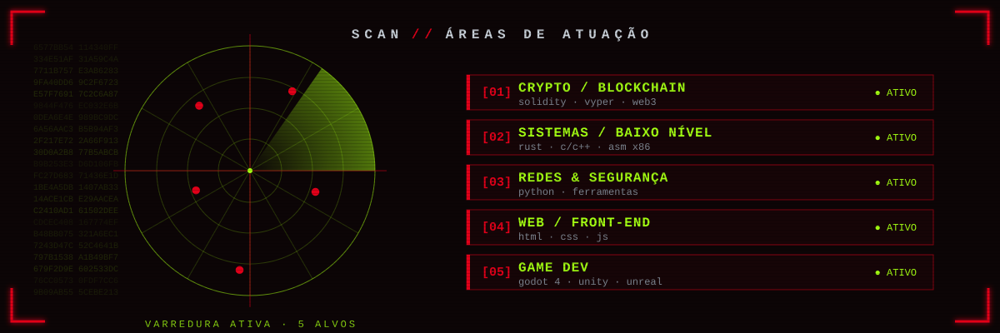

*Estudante de Cyber Security, desenvolvedor Blockchain/Web3 e entusiasta de programação de sistemas.*

 

### `[ 01 // LINGUAGENS ]`

### `[ 02 // BLOCKCHAIN & CRIPTO ]`

### `[ 03 // WEB & GAME DEV ]`

### `[ 04 // SISTEMAS OPERACIONAIS ]`

### `[ 05 // RADAR DE ATUAÇÃO ]`

### `[ 06 // TELEMETRIA ]`

<table>
  <tr>
    <td align="center">
      
    </td>
    <td align="center">
      
    </td>
  </tr>
</table>

  

 

